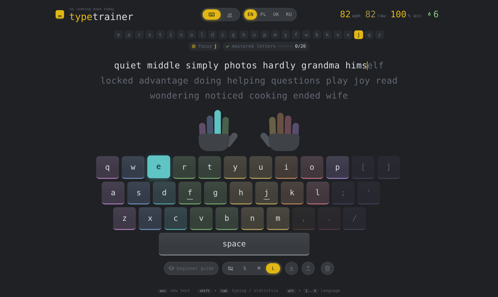
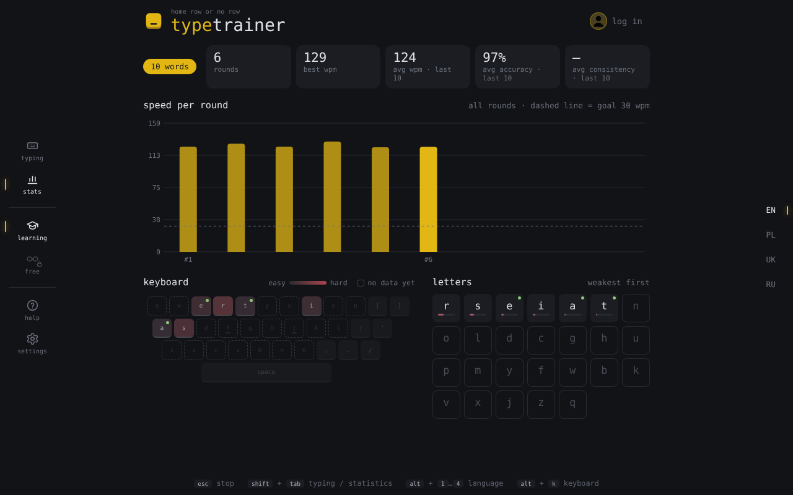
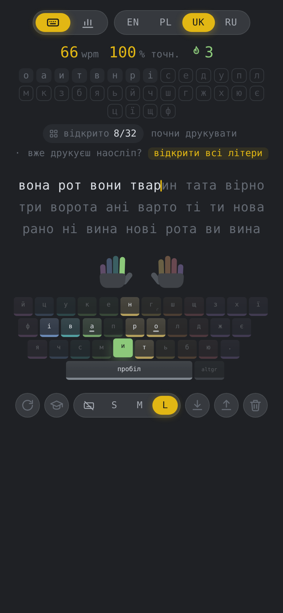

<p align="center">
  
</p>

<h1 align="center">typetrainer</h1>

<p align="center"><sub><i>eyes up, fingers down</i></sub></p>

<p align="center">
  A touch-typing trainer that <b>finds your weakest letters</b><br>
  and builds every exercise from <b>real words</b> around them.
</p>

<p align="center">
  <a href="https://69inoi69.github.io/typing-trainer/"><b>▶&nbsp; Try it in your browser</b></a>
  &nbsp;·&nbsp; <a href="docs/ALGORITHM.md">How it works</a>
  &nbsp;·&nbsp; <a href="#run-it-on-your-computer">Run it locally</a>
</p>

<p align="center">English · Polski · Українська · Русский</p>

<p align="center">
  
</p>

---

## Why

Monkeytype is great for **measuring** how fast you type. keybr.com **teaches**,
but with made-up letter salad like *"tetsna nartse"*. typetrainer sits in
between: it teaches touch typing step by step, and you only ever type **real
words**.

## What it does

- **Watches every keypress.** For each letter it keeps track of how often you
  miss it and how long it takes you, and turns that into one difficulty score.
- **Practises what you are bad at.** Each new exercise is picked so your weak
  letters show up much more often, while the strong ones still appear.
- **Opens letters gradually.** You start with the most common ones; a new
  letter opens once every open letter is accurate and fast enough. Already a
  touch typist? Open everything at once.
- **Shows which finger to use.** Two hands above the keyboard light up the
  right finger for the next key.
- **Four languages, one progress each.** English, Polish, Ukrainian and Russian,
  with their own keyboard layouts and word lists.
- **Shows where it is hard.** A statistics screen with your speed over time and
  a keyboard coloured by difficulty.
- **No restart on Tab.** On purpose: restarting throws away exactly the mistakes
  the trainer learns from.
- **One mode, no settings to tune.** The algorithm decides what you practise.

<p align="center">
  
  &nbsp;
  
</p>

## How it works, in 30 seconds

```
every letter:   how often you miss it  +  how slow it is   →  difficulty 0 … 1
little data?    assume the letter is fairly hard until there is evidence
next exercise:  pick a weak letter (softmax: weaker = much more likely),
                then a real word that contains it (and other weak letters)
mastered:       20+ presses, under 5 % mistakes, 30 wpm or faster
all mastered:   the next letter opens
```

Every formula, every number and the reasons behind them are in
[**docs/ALGORITHM.md**](docs/ALGORITHM.md).

## Run it on your computer

You need [Go](https://go.dev/dl/) 1.22 or newer. Then, in the project folder:

```
go run .
```

and open <http://localhost:3000>. That is all: no database, no npm, no build step.

<details>
<summary><b>Step by step on Windows (from zero)</b></summary>

1. **Install Go** (once): download the Windows installer from
   <https://go.dev/dl/> (`go1.24.x.windows-amd64.msi` or newer) and click Next
   until it finishes.
2. **Check it works.** Open a *new* PowerShell window (Start → `powershell` →
   Enter) and run `go version`. You should see something like
   `go version go1.24.7 windows/amd64`.
3. **Go to the project folder**, for example
   `cd C:\Users\YOUR_NAME\Downloads\typing-trainer`.
4. **Start the server:** `go run .`. The first run takes a few seconds, then you
   see `Typing trainer running. Open http://localhost:3000 in your browser`.
   If Windows asks about the firewall, "Allow" is fine.
5. **Open** <http://localhost:3000>. Always use this address: double-clicking
   `web/index.html` opens the page without the server, with no words and no
   statistics. If the port is taken, change `Addr` in
   `internal/config/config.go`.
6. **Stop** the server with `Ctrl + C`. Progress lives in memory for now, so
   save it first with the export button (⬇) and load it back (⬆) next time.

Optional: `go build -o typing-trainer.exe .` makes one `.exe` you can double-click.

</details>

Tests: `go test ./...`

## Built with

- **Go**, standard library only (`net/http`), no frameworks.
- **Plain HTML, CSS and JavaScript**, no frameworks, no npm.
- **WebAssembly** for the website: GitHub Pages can only host static files, so
  the same Go code is compiled to WebAssembly and runs inside the browser.
  Every push to `main` runs the tests and republishes the site.
- **Storage** sits behind one `Store` interface: in memory today,
  PostgreSQL next.

<details>
<summary><b>Project structure</b></summary>

```
typing-trainer/
├── setup.go                      loads data files, wires the packages together
├── main.go                       entry point: normal web server (go run .)
├── main_wasm.go                  entry point: WebAssembly build for GitHub Pages
├── pages/wasm-shim.js            Pages only: sends /api/v1 calls to the Go code in the browser
├── .github/workflows/pages.yml   builds and publishes the Pages version
├── data/
│   ├── languages.json            the four languages: name, layout, alphabet
│   ├── langs/<id>/words.txt      2000 most frequent words per language
│   └── layouts/*.json            keyboard layouts + finger mapping (data, not code)
├── tools/wordlists/              script + block lists that build the word lists
├── tools/devlog/                 script that builds docs/DEVELOPMENT-LOG.pdf
├── docs/                         algorithm, architecture, user guide, reading list, development log
├── internal/
│   ├── config/config.go          all tunable numbers
│   ├── engine/model.go           the math: EMA, difficulty, mastery, softmax
│   ├── engine/generator.go       unlocking letters, choosing words
│   ├── storage/                  Store interface + in-memory implementation
│   ├── layout/, language/        load and check layouts and languages
│   └── api/handlers.go           JSON API under /api/v1/
└── web/                          index.html, style.css, app.js, i18n.js, fx.js
```

A new language is data only: an entry in `data/languages.json`, a layout in
`data/layouts/` and a word list in `data/langs/<id>/`. PostgreSQL will be a new
file in `internal/storage/` implementing the same `Store` interface, plus one
changed line in `setup.go`.

</details>

## Documentation

| | |
|---|---|
| [User guide](docs/USER-GUIDE.md) | every screen, button and shortcut |
| [Algorithm](docs/ALGORITHM.md) | the adaptive model: formulas, parameters, why it is built this way |
| [Architecture](docs/ARCHITECTURE.md) | packages, data flow, API, how to add PostgreSQL |
| [Reading list](docs/LITERATURE.md) | sources on typing, learning and adaptive practice |
| [Development log](docs/DEVELOPMENT-LOG.pdf) (PDF) | how the project was built: decisions, reasons, workflow, every commit |

## Word lists and credits

The words are the 2000 most frequent words of each language from
[FrequencyWords](https://github.com/hermitdave/FrequencyWords) by Hermit Dave,
counted in the OpenSubtitles 2018 corpus. **Word data license: CC BY-SA 4.0.**
The filtering steps are described in [docs/ALGORITHM.md](docs/ALGORITHM.md),
section 12.

<details>
<summary>Rebuild the word lists (Python 3)</summary>

```
git clone --depth 1 https://github.com/hermitdave/FrequencyWords
python tools/wordlists/build.py FrequencyWords/content/2018
```

</details>

## About

typetrainer is the practical part of an engineering thesis at the
**Lublin University of Technology** (2027), made by
[@69inoi69](https://github.com/69inoi69). Ideas and feedback are welcome in the
[issues](https://github.com/69inoi69/typing-trainer/issues).
