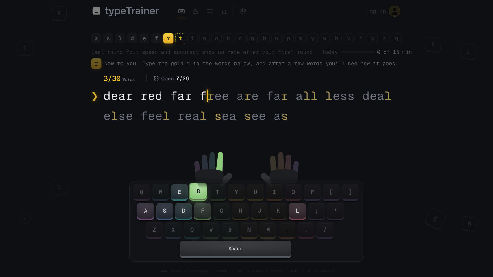

<p align="center">
  
</p>

<h1 align="center">typeTrainer</h1>

<p align="center">
  Looks like Monkeytype. Teaches like keybr. Real words only.<br><br>
  <a href="https://69inoi69.github.io/typeTrainer/"><b>Start typing</b></a>
  ·
  <a href="docs/USER-GUIDE.md">Guide</a>
  ·
  <a href="docs/ALGORITHM.md">How it works</a>
</p>

<p align="center">
  <a href="https://github.com/69inoi69/typeTrainer/actions/workflows/pages.yml"></a>
  <a href="LICENSE"></a>
</p>

<p align="center">
  
</p>

## About

Most typing sites either look great and leave you to it, or teach you well
and look like a lab tool. typeTrainer tries to do both. It times every key
you press, notices which letters slow you down or trip you up, and picks
the next words around them. You never type `jjf kkd`: every word is a word
you could meet in a book.

No account and no install: open the site and type. Your progress stays in
your browser.

## Three modes

- **Learn** starts from the home row and opens one letter at a time, once
  you type the open ones cleanly and fast enough. The gold letter is the one
  you need most right now, and the words are picked to give you more of it.
- **Climb** is for when you can already type. Ten levels, from the 200 most
  common words to 25 000. Three clean rounds and you go up, two sloppy ones
  and you go down. Only accuracy counts here, so slow down and get it right.
- **Freetype** is just typing, like on Monkeytype: a word list of your
  choice, only its long words, real sentences with punctuation, or a text
  you paste yourself.

## Also

- Stats that tell you something: your best for every round length, every
  round's speed, Learn's letters round by round, the keys you mix up.
- An on-screen keyboard in finger colours, with a small hand above the next
  key and the next letter in its finger's colour, so you learn where each
  finger goes instead of looking down.
- Dark and light themes, caret styles, sounds, a daily goal and the rest of
  the settings you would expect.
- Export and import, so you can move your progress to another browser.

A computer keyboard is needed to practise. On a phone the site shows your
stats only.

## Run it yourself

You need [Go](https://go.dev/dl/) 1.25 or newer.

```
go run .
```

Then open <http://localhost:3000>. Accounts and a PostgreSQL database are
optional; [CONTRIBUTING.md](CONTRIBUTING.md) has the details.

## Contributing

Bug reports, ideas and pull requests are welcome. Start with
[CONTRIBUTING.md](CONTRIBUTING.md): how to run the tests and the few rules
the code follows. How the parts fit together is in
[docs/ARCHITECTURE.md](docs/ARCHITECTURE.md).

## Credits

- Word frequencies: [FrequencyWords](https://github.com/hermitdave/FrequencyWords)
  by Hermit Dave (OpenSubtitles 2018), **CC BY-SA 4.0**.
- Sentences: [Tatoeba](https://tatoeba.org), **CC BY 2.0 FR**.
- The long English list is checked against the en_US
  [Hunspell dictionary from SCOWL](http://wordlist.aspell.net/) (via
  [wooorm/dictionaries](https://github.com/wooorm/dictionaries)) and
  [LDNOOBW](https://github.com/LDNOOBW/List-of-Dirty-Naughty-Obscene-and-Otherwise-Bad-Words)
  (**CC BY 4.0**) to leave out names and offensive words.
- Fonts: [Geist Mono](https://github.com/vercel/geist-font) and
  [Sora](https://github.com/sora-xor/sora-font), **SIL OFL 1.1**.
- The look owes a lot to [Monkeytype](https://github.com/monkeytypegame/monkeytype),
  the teaching to [keybr](https://www.keybr.com).

How the word lists were made: [docs/ALGORITHM.md](docs/ALGORITHM.md),
sections 11 and 13.

## License

[GPL-3.0](LICENSE). typeTrainer started as an engineering thesis at the
Lublin University of Technology; the thesis notes live in
[docs/thesis](docs/thesis/).
